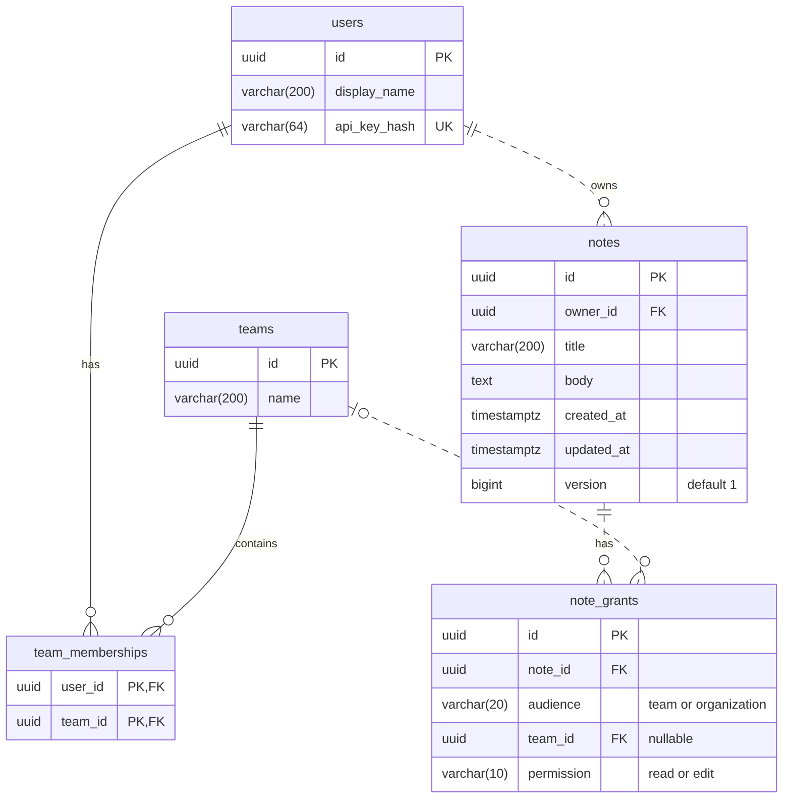
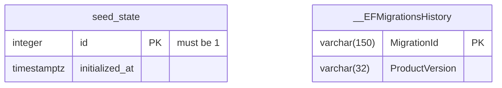

# Database schema

The PostgreSQL `notes` database uses the `public` schema. It contains five
application tables and two maintenance tables, shown separately below for
readability. GitHub renders the Mermaid diagrams directly in this document.

This describes the implemented schema in
[NotesDbContext](src/Notes.Api/Data/NotesDbContext.cs) and the committed
[initial migration](src/Notes.Api/Data/Migrations/20261114210939_InitialSchema.cs).
Update this document alongside migrations that change tables, columns, keys,
constraints, or indexes. The [specification](SPEC.md#6-relational-model)
describes the logical model and application behavior.

## Application tables

`PK` means primary key, `FK` means foreign key, and `UK` means unique key.
The two `PK` columns in `team_memberships` form one composite primary key.
All columns are **NOT NULL** except `note_grants.team_id`.
`varchar(n)` and `timestamptz` are PostgreSQL aliases for
`character varying(n)` and `timestamp with time zone`.

Bars mean one, circles allow zero, and crow's feet mean many. Solid links
contribute to the membership row's composite primary key; dotted links are
foreign keys that are not part of the child table's primary key.

### Ownership and sharing

Users can belong to multiple teams through `team_memberships`. Every note has
exactly one individual owner and zero or more sharing grants. Ownership is
stored in `notes.owner_id`, not as a grant.

A team grant has `audience = 'team'` and a non-null `team_id`. An organization
grant has `audience = 'organization'` and a null `team_id`, which explains the
optional team relationship in the diagram. There is no organization or tenant
table: this deployment represents one organization, and organization grants
cover every authenticated user.

The owner always retains full control. Other users receive the strongest
matching grant; `edit` includes read access but does not allow deletion or
sharing administration. See the [access matrix](SPEC.md#5-access-matrix).
These authorization rules are enforced by the application, not by the
foreign keys alone.

`notes.version` is an optimistic concurrency token covering both content and
sharing changes. It is not a revision-history table; old note contents are not
retained. Direct SQL edits do not run the API's validation, authorization, or
version-update logic.

## Database-enforced constraints

| Table | Rule |
| --- | --- |
| `users` | `api_key_hash` is unique and must match `^[0-9A-F]{64}$`: a SHA-256 hash encoded as 64 uppercase hexadecimal characters, not a raw API key. |
| `team_memberships` | The composite primary key `(user_id, team_id)` prevents duplicate membership pairs. |
| `notes` | `char_length(title)` is between 1 and 200; `octet_length(body)` is at most 65,536 bytes; `version` is positive and defaults to 1. |
| `note_grants` | `audience` and `team_id` must form one of the two combinations described above. `permission` must be `read` or `edit`. |
| `note_grants` | Partial unique indexes allow at most one grant per `(note_id, team_id)` for teams and one organization grant per note. |
| `seed_state` | The primary key must be `id = 1`, so the table can contain at most one row. |

### Foreign keys and deletion

The action applies when deleting the referenced parent row.

| Foreign key | References | On delete |
| --- | --- | --- |
| `team_memberships.user_id` | `users.id` | `CASCADE`: remove the user's membership rows. |
| `team_memberships.team_id` | `teams.id` | `CASCADE`: remove the team's membership rows. |
| `notes.owner_id` | `users.id` | `RESTRICT`: a user who still owns notes cannot be deleted. |
| `note_grants.note_id` | `notes.id` | `CASCADE`: remove the deleted note's grants. |
| `note_grants.team_id` | `teams.id` | `RESTRICT`: a team that still has note grants cannot be deleted. |

### Indexes

PostgreSQL also creates unique indexes for each primary key shown in the
diagrams. The additional indexes are:

| Index | Table | Columns | Uniqueness / filter |
| --- | --- | --- | --- |
| `ux_users_api_key_hash` | `users` | `api_key_hash` | Unique. |
| `ix_team_memberships_team_user` | `team_memberships` | `team_id, user_id` | Non-unique; supports lookups starting with a team. |
| `ix_notes_owner` | `notes` | `owner_id` | Non-unique. |
| `ix_notes_listing` | `notes` | `created_at DESC, id DESC` | Non-unique; matches the note listing order. |
| `ux_note_grants_team` | `note_grants` | `note_id, team_id` | Unique where `audience = 'team'`. |
| `ux_note_grants_organization` | `note_grants` | `note_id` | Unique where `audience = 'organization'`. |
| `ix_note_grants_access` | `note_grants` | `note_id, permission, team_id` | Non-unique. |
| `ix_note_grants_team` | `note_grants` | `team_id` | Non-unique. |

## Maintenance tables

These tables have no foreign-key relationships to the application tables.
Their columns are all **NOT NULL**.

`seed_state` records completion of initial demo seeding so that restarting the
application does not recreate deleted example notes or grants.

`__EFMigrationsHistory` is managed by EF Core and records applied migrations
and the EF Core version that applied them. It is migration metadata, not note
history. Its mixed-case table and column names require double quotes when
referenced in SQL. Do not edit either maintenance table as part of ordinary
note editing.
